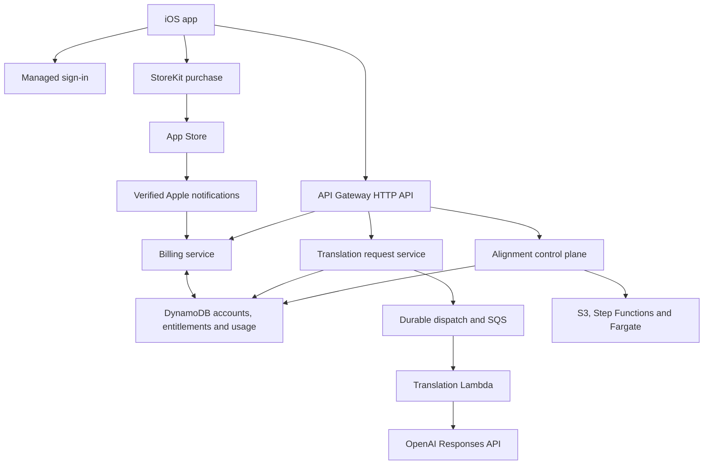

# Paid cloud backend: subscriptions, translations and alignment

**Status:** Proposed implementation plan; no implementation, deployment or tariff approval.  
**Updated:** 2026-10-30.  
**Scope:** Extend the existing AWS alignment architecture with account identity, Apple subscription verification, service-operated AI translation and durable usage limits.

## 1. Existing system and document map

- [AWS alignment architecture](AWS_ALIGNMENT_BACKEND_ARCHITECTURE.md): HTTP API, upload protocol, job lifecycle, security boundaries and iOS integration plan.
- [Backend README](../backend/alignment/README.md): implemented Python components and validation commands.
- [CDK stack](../infra/alignment/lib/alignment-stack.ts): existing AWS infrastructure definition.
- [Alignment benchmark gate](ALIGNMENT_BENCHMARKS.md): uncompleted measurements required before alignment deployment.
- [Future improvements](FUTURE_IMPROVEMENTS.md): previously deferred identity, account recovery, quotas and production operations.
- [Decisions](../knowledgebase/DECISIONS.md): current local-first, capability-scoped alignment and bring-your-own-key (BYOK) boundaries.

The repository describes an **undeployed public-test alignment backend**: API Gateway HTTP API → Python Lambda → DynamoDB and Step Functions Standard → CPU Fargate worker, with private temporary S3 storage. Its bearer token authorizes exactly one job; it does not identify an account. Global admission counters bound test usage. Deployment still requires measured quality, duration, memory and cost headroom.

The shipped app calls OpenAI directly with the user's Keychain API key. ContextAnalysisService creates OpenAIContextAnalysisProvider; WordExplanationService creates OpenAIWordExplanationProvider. Ordinary Apple Translation is a separate on-device workflow. No subscription or shared translation service is implied by this plan.

Some older paragraphs in the alignment documents still say Polish-only; the newer multilingual contract and current validators support en/fr/es/de/it/pl. Use the current contract when implementing this plan. Historical review findings must be revalidated rather than treated as current defects.

## 2. Proposed architecture and release boundary

Keep AWS in eu-central-1, Python server modules and TypeScript CDK. Split infrastructure into independently deployable foundation, billing, translation and alignment components. The existing stack requires a worker image digest at construction: billing and translation must no longer depend on that image or on alignment benchmark completion.

Recommended first release: account-backed AI translation with a bounded subscription allowance. Paid alignment follows its independent benchmark and release gate. Apple processes purchases; our billing service verifies access, without processing card payments.

Use separate IAM roles and storage boundaries. Translation workers cannot read alignment media; alignment workers cannot read provider keys or billing data. Keep translation Lambdas outside the worker VPC unless a measured requirement justifies network changes. Do not introduce a permanently running server or NAT Gateway solely for translation.

Suggested module locations are backend/billing/, backend/translation/ and a small shared identity/usage module. Shared code does not require sharing one Lambda or granting every component all database permissions.

## 3. Identity, ownership and recovery

Recommended identity option: Cognito User Pool with Sign in with Apple. Final login UX and provider configuration remain implementation prerequisites. Local reading, import and practice stay available without an account; paid cloud operations require a recoverable account.

- Derive internal user_id from a verified session. Never trust an owner ID in request JSON.
- Require access tokens with the intended issuer, audience/client and scopes on user API routes. Subscription status is checked server-side rather than copied into a long-lived token.
- Define refresh, expiry, sign-out, revoked/deleted-account checks and cross-device recovery. JWT signature validation alone is not immediate account revocation.
- Assign a stable server-managed UUID appAccountToken to each account and supply it to StoreKit purchases. It links transactions to an account; it is not authentication.
- Enforce unique ownership of each (environment, originalTransactionId) subscription chain. A different signed-in account cannot silently adopt a restored purchase. Define an explicit support/recovery path for conflicts or missing legacy bindings.
- Include account deletion and explain that deletion does not itself cancel an App Store subscription. Define retention of minimal transaction/audit records separately from user content, and provide subscription management access.

This proposes a new paid-service boundary, not a retroactive change to the existing anonymous test API. Keep any public test endpoint in an isolated development environment; never leave an anonymous path to paid compute in production.

## 4. Apple billing contract

| Route | Authorization and behavior |
|---|---|
| POST /v1/billing/apple/sync | User session; validate a purchase/restore and return current server access |
| GET /v1/me/entitlements | User session; return features, access expiry, allowance/reset information and policy version |
| POST /v1/webhooks/apple | No user JWT; verify Apple-signed notification before accepting it |

Purchase flow:

1. Signed-in app obtains its appAccountToken and loads products from StoreKit.
2. Apple handles purchase approval; the app handles cancellation, pending purchase and verified success distinctly.
3. App sends signed transaction data to the sync route. Server verifies JWS with Apple's supported server library, certificate trust and expected bundle/app identity, product allowlist, environment and account binding.
4. Reconcile current status with App Store Server API when necessary. An authentic old transaction alone must not override a later refund or revocation.
5. Persist transaction and entitlement state atomically/idempotently, then return access. A server outage after purchase shows a recoverable activation state; do not invite a second purchase. StoreKit transaction completion and recovery must be explicitly covered in the client design.

Store account mapping, product, originalTransactionId, transaction IDs, access expiry, status, environment, verified timestamps and policy version. Access states distinguish subscribed, grace period, billing retry without grace, expired and revoked. Turning off auto-renewal normally preserves access until the paid period ends. Grace-period access follows the verified Apple state and selected product policy.

Use App Store Server Notifications V2. Verify and durably record notifications before acknowledging them; process asynchronously, deduplicate by notification UUID and reconcile out-of-order events instead of blindly applying arrival order. Retry failed processing with a dead-letter path and alarms. Periodic reconciliation repairs missing events. Check expiry on every paid admission even if notifications are delayed.

Keep sandbox and production records, endpoints/configuration, provider credentials and allowances separate. A sandbox purchase must never grant production service access. TestFlight may consume a deliberately budgeted development provider project.

Do not call Apple for every translation. Use the server entitlement projection with expiry and a defined freshness/reconciliation policy. If current entitlement cannot be established, return a retryable service state rather than trusting a client premium flag.

## 5. Translation API and provider boundary

| Route | Behavior |
|---|---|
| POST /v1/context-analyses | Admit selected-phrase translation and word breakdown |
| POST /v1/word-explanations | Admit contextual word meaning and example generation |
| GET /v1/requests/{id} | Owner-only status/result; no access by request ID alone |

POST uses Idempotency-Key, verifies entitlement, reserves allowance and returns 202 with request ID/status. Request payload contains selected text, bounded context, source/target languages and selection location. It contains no provider key, arbitrary provider URL, unrestricted model name or arbitrary tools.

Start with current client limits: 256 UTF-16 code units for selected phrase and 1,400 for context. Enforce UTF-16 semantics in Python explicitly; Python string length differs for supplementary characters. Validate that the selection range identifies the submitted text. Match the supported source languages and current Russian target contract. Version the request/response schema.

The server owns model allowlists, prompts, output schemas, output-token ceilings, deadlines and retry policy. Preserve current structured phrase/word outputs and validation, including ordered word explanations and valid word selections. Decide whether to reproduce the client tokenizer on the server or accept and strictly validate a bounded ordered word list; contract fixtures must cover repeats and all supported languages.

Store the service API key in Secrets Manager, readable only by the translation worker. Use a dedicated provider project per environment. Preserve store:false in Responses requests, without claiming that it guarantees zero provider retention. Disclose that selected text/context is sent through our backend to the provider. Send only the bounded excerpt, never an entire book implicitly.

Custom local prompts/model selection belong to existing BYOK behavior. For subscription requests, offer only explicitly supported server presets unless a bounded customization policy is later approved. Version the effective model/prompt policy in responses and cache keys.

### Durable execution and uncertain outcomes

HTTP API integration has a 30-second maximum timeout. Use a durable asynchronous request rather than extending the current client's synchronous timeout:

1. In one transaction, reserve quota and persist the request plus durable dispatch intent.
2. Dispatch to SQS through an outbox/stream mechanism with reconciliation. A crash between database write and queue publication must not strand a reservation.
3. Worker conditionally claims the request before provider submission. Queue duplicates must not submit another provider request.
4. Validate the result, persist it and settle usage once. The app polls with bounded backoff and resumes by ID after a connection loss or relaunch.

Suggested states: accepted → running → succeeded | failed | outcome_unknown; cancelled is possible before dispatch. Use revisions/leases and a watchdog for abandoned requests. A lease timeout after provider submission is not permission to blindly execute again. A lost provider response may already have incurred cost; record outcome_unknown and reconcile if possible. Do not promise exactly-once external inference without provider support.

Client retries reuse the same key and payload. Reusing a key with different content returns conflict. A fresh, intentional request has a new key. The existing client's automatic retry must not create new billable operations after a timeout. Cancelling UI waiting after dispatch does not guarantee cancellation of provider work or reversal of cost.

## 6. Usage accounting and content lifecycle

Keep three concepts separate: verified subscription entitlement, user-facing allowance, and internal provider/AWS cost. Define feature allowances through a versioned product policy. Numeric quotas and prices are not selected by this document.

- Atomically reserve available allowance before admission; concurrent requests cannot overspend it.
- Store request ID, owner, period ID, request fingerprint, reservation, settlement and usage metadata.
- Settle once on a valid result. Define how validation failures, provider failures, cancellation and uncertain outcomes affect user allowance versus internal cost; these may differ.
- Pin the quota period on admission so a completion after reset settles the original period. Decide calendar versus subscription-anchored reset, annual-plan monthly allowance, trial quotas and upgrade/downgrade rules before coding billing policy.
- Enforce per-account frequency/concurrency limits and global admission limits. Include separate operator switches for new translations and new alignments; budget alerts alone do not stop spending.

Store accounts/entitlements, billing events, usage/reservations and temporary translation requests separately from the existing short-lived alignment job table. Billing and audit records must not inherit the alignment table's deletion deadlines.

Proposed content policy: retain translation input only until terminal processing; expose successful results for a short documented recovery window, initially proposed as 24 hours. Specify handling of outcome_unknown and cap its content retention too. Enforce access expiry in application code and use scheduled deletion; database TTL is a fallback, not a deletion guarantee. Select minimal metadata retention and backup retention before launch. No cross-user content cache in the first release.

Logs contain safe IDs, durations, error categories and token/cost counts, not source text, prompts, responses, authorization headers or raw signed purchase payloads. Existing locally saved translations remain local artifacts after server access expires.

## 7. iOS integration and alignment migration

Add account/session, StoreKit purchase/restore and entitlement services. Introduce backend providers behind ContextAnalysisService and WordExplanationService, replacing their direct API-key requirement for the subscription path. Preserve structured results, stale-selection guards, explicit dictionary saving, bounded local work and cancellation semantics.

Version cache keys by provider mode and effective server policy so BYOK/custom-prompt results are not confused with subscription results. Handle sign-out/account change for pending remote requests and account-scoped caches. Existing saved dictionary content is not deleted by subscription expiry.

BYOK retention is an open product choice; the recommended migration keeps it as an explicit separate mode. Never silently fall back to the user's personal key after a subscription quota/error. Ordinary Apple Translation remains independent.

For paid alignment:

- Introduce account-authorized routes, proposed as /v2/alignments. Existing /v1 capability tokens and session JWTs must not ambiguously share Authorization semantics.
- Bind owner server-side; check ownership on all reads, downloads, cancellation and upload renewal. Do not automatically adopt old anonymous jobs without proven capability possession and an explicit migration policy.
- Check access on create and start. Combine per-user reservation with current global admission and durable start intent; finalization/cancellation settles once.
- If charged in audio minutes, reserve conservatively before verified probing and reconcile to measured duration before expensive inference. Client-declared duration is not trustworthy. Retain upload/storage limits even for rejected inputs.
- Proposed policy: already admitted work may finish after subscription expiry, and its owner can retrieve it within normal retention. New compute needs current access. Failure/refund/cancellation quota rules require product approval.
- Preserve pinned S3 versions, private artifacts, one-attempt compute, manifest finalization and independent cleanup. Current global test caps remain until explicitly replaced by measured production limits.

## 8. Delivery sequence and acceptance

| Phase | Deliverable and gate |
|---|---|
| 1. Product contracts | Choose account flow, products, quota/reset policy, BYOK migration, recovery/conflict rules and retention |
| 2. Foundation | Independent dev/prod stacks, identity, secrets, tables, authorization and deletion/recovery contract |
| 3. Billing | Sandbox purchase/restore, verified events, entitlement projection and reconciliation |
| 4. Translation | Durable admission/dispatch, two operations, provider validation, quotas and iOS adapters |
| 5. TestFlight | End-to-end purchase and cloud use, bounded development spend and operational runbooks |
| 6. Production AI | Approved Apple products/app, production isolation, monitoring and reviewed service policy |
| 7. Paid alignment | Completed existing benchmark gate plus ownership, quotas and paid-operation tests |

Required acceptance cases:

- Invalid signatures, wrong app/product/environment and foreign-account purchases grant no access; restore on a second device recovers the same account's entitlement.
- Duplicate/out-of-order/lost notifications, renewals, auto-renew cancellation, grace period, expiry and refunds converge to correct access.
- Concurrent quota reservations never exceed allowance; duplicate submission/queue delivery and crash recovery do not double-settle usage.
- Exercise crashes before dispatch, before provider submission, after provider submission and after result persistence; unknown outcomes never trigger an unbounded retry loop.
- Cross-account request/job IDs cannot expose content; account deletion/revocation blocks new cloud work.
- Lost network/relaunch retrieves an existing result; expiry/reset boundaries, failed purchases and provider outages have recoverable UI states.
- UTF-16 selections, repeated words and multilingual structured outputs match existing product behavior.
- Logs exclude content/credentials; temporary content is inaccessible after expiry and physically cleaned up, including applicable backups/retention controls.
- AI deployment succeeds without an alignment image; alignment remains undeployable until its own gate is satisfied.

Roll out behind independent feature flags. Stop new admissions during an incident while preserving purchase synchronization, webhook processing, already accepted work and result retrieval where safe. Retain compatible schema versions and avoid destructive migrations during rollback.

Each implementation PR updates CHANGELOG.md and DECISIONS.md, and PROJECT.md when shipped workflows/boundaries actually change. This planning document does not mark any phase complete.

## 9. Decisions still required

1. Subscription benefits, prices, trial and exact AI allowance; reset timing for monthly and annual products.
2. Account requirement/UX and recovery when App Store and app accounts do not match; Family Sharing scope.
3. BYOK availability and handling of existing custom models/prompts.
4. User allowance policy for failures, uncertain outcomes and cancellation.
5. Alignment inclusion versus separate allowance, after measured unit cost.
6. Content/metadata retention, deletion policy and production operating budget.

## 10. External references

Reviewed while preparing the plan on 2026-10-29; recheck relevant platform contracts during implementation.

- [Apple appAccountToken](https://developer.apple.com/documentation/appstoreservernotifications/appaccounttoken): association of transactions with service accounts.
- [App Store Server Notifications](https://developer.apple.com/documentation/appstoreservernotifications/): V2 lifecycle events.
- [App Store Server API](https://developer.apple.com/documentation/appstoreserverapi): subscription and transaction reconciliation.
- [Apple submission workflow](https://developer.apple.com/help/app-store-connect/manage-submissions-to-app-review/submit-an-in-app-purchase/): review of the first subscription with an app version.
- [AWS HTTP API JWT authorizers](https://docs.aws.amazon.com/apigateway/latest/developerguide/http-api-jwt-authorizer.html): route-level token validation.
- [AWS HTTP API quotas](https://docs.aws.amazon.com/apigateway/latest/developerguide/http-api-quotas.html): maximum integration timeout.
- [OpenAI API authentication](https://developers.openai.com/api/reference/overview): keep service credentials on the server.
