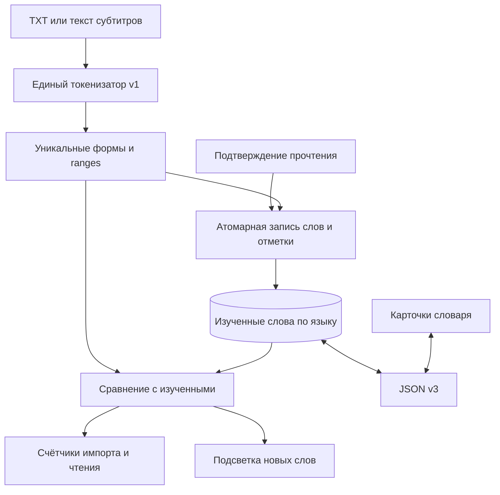

# Изученные слова из прочитанных текстов

Обновление 2026-10-19: [быстрый индекс и счётчики библиотеки](READING_VOCABULARY_INDEX_ARCHITECTURE.md) реализованы. Этот дополнительный документ заменяет описанные ниже детали хранения знаний, повторного анализа и оформления всего документа; продуктовые правила сохраняются.

Дата: 2026-10-18. Основание: анализ кода на commit `d0ae4bc` и ответы владельца продукта.
Статус: реализовано 2026-10-18. Документ сохраняет пошаговый контракт для сопровождения; раздел 14 описывает уточнения реализации и проверку.
Адресат: агент младшей модели. Следовать этапам ниже; не переопределять продуктовые правила самостоятельно.

## 1. Подтверждённые продуктовые решения

1. Словоформы считаются отдельно: `kot`, `kota`, `kotem` — три слова. Лемматизация не нужна.
2. «Прочитано» — одноразовое действие с обязательным подтверждением. Снять отметку нельзя. Первоначальная интерпретация ответа об отмене была исправлена пользователем; отмену не реализовывать.
3. Все слова текста подтверждённой главы/книги входят в изученные. Повторения не увеличивают число уникальных изученных слов.
4. Только прочитанные тексты определяют изученность. Карточки словаря, их уровни, переводы и тренировки не влияют на это множество. Новые карточки автоматически не создаются.
5. У главы без субтитров разрешается отметка прочтения, но слова начисляются только при отметке всей книги. Не угадывать границы главы в общем TXT.
6. Нужна отдельная кнопка отметки всей книги. Импорт показывает число новых слов относительно уже изученных. Подтверждение главы обновляет счётчики.
7. Состояние изученных слов включается в общий файл бэкапа вместе со словарём и восстанавливается без наличия книг.
8. В режиме прослушивания подсвечиваются все вхождения слов, которых ещё нет в изученном множестве. «Контекст» здесь означает накопленные прочитанные тексты, а не текущий абзац или OpenAI Meaning in context.

### Уточняющие проектные решения этого документа

Следующие детали выбраны архитектурой, а не являются дополнительными ответами пользователя:

- Удаление книги не удаляет изученные слова. Это согласуется с одноразовым накопительным действием и переносимостью бэкапа.
- Уникальность определяется парой `(язык, нормализованная словоформа)`. Одинаковое написание в разных языках — разные записи.
- Счётчики актуальные, а не зафиксированные на момент импорта. Сравнение книги учитывает в том числе её уже прочитанные главы.
- Импорт сам по себе ничего не делает изученным. Завершение аудио, прокрутка и длительность прослушивания также не ставят отметку.
- Отметка всей книги выставляет все её главы завершёнными и добавляет слова полного текста; для сохранения смысла отметок глав также учитывает доступные тексты их субтитров. Подтверждение явно описывает оба источника.
- Прочтение всех глав само по себе НЕ означает прочтение полного TXT: он может содержать текст без субтитров. Кнопка всей книги остаётся доступной до отдельного подтверждения.
- Подсветка включена по умолчанию; переключатель «Новые слова» влияет только на отображение. В первой версии применяется в обоих reader-экранах, включая Full text, и остаётся видимой на паузе.

## 2. Как устроено сейчас и куда вносить изменения

| Файл | Фактическое состояние / точка интеграции |
| --- | --- |
| `App/Models/LibraryModels.swift` | SwiftData `LearningItem`, Codable `LearningTrack` и `LearningPart` с `isCompleted`. `TranscriptDocument` хранит текст и UTF-16 ranges. Отдельного словарного запаса и отметки всей книги нет. |
| `App/Views/BookReaderView.swift` | Отметка трека сейчас переключается через `toggle()` и `try? context.save()`. Полный TXT читается с диска; субтитры грузятся отдельно по track ID. |
| `App/Views/ReaderView.swift` | Аналогичный toggle для виртуальной части. Документ части выбирает cues, пересекающиеся с временным диапазоном. Здесь же меняется язык исходного материала. |
| `App/Views/TranscriptTextView.swift` | Native UITextView, выделение текста, follow. Звучащий cue подсвечивается через `.backgroundColor`; смена документа сбрасывает выделение. |
| `App/Services/BookImportService.swift` | Actor; staged preview/prepare/commit, выбранный TXT, security-scoped внешний файл, строгие лимиты и журнал транзакций. |
| `App/Views/BookImportView.swift` | Предпросмотр ZIP, выбор TXT/языка, создание LearningItem. |
| `App/Services/MediaImportService.swift`, `App/Views/ImportItemView.swift` | Старый путь одиночного audio/video + TXT/SRT/VTT. Его также нужно поддержать. |
| `App/Services/DictionaryTransferService.swift` | JSON v2, чтение v1–v2, preview и три режима применения, максимум 20 MiB / 50 000 карточек, rollback при ошибке. |
| `App/Views/DictionaryView.swift` | Export/import и отображение preview бэкапа. |
| `App/ForeignLanguageLearnerApp.swift` | Регистрация моделей контейнера; сейчас только LearningItem и DictionaryEntry. |
| `App/ContentView.swift` | Библиотека, recovery и удаление. Сейчас удаление книги удаляет также привязанные DictionaryEntry; новый запас слов НЕ должен попасть под это удаление. |
| `docs/dictionary.schema.json` | Сейчас описывает v1, хотя код экспортирует v2. Согласовать схему с фактическими v1/v2 и новой v3. |

Существующие решения в `knowledgebase/DECISIONS.md` сохраняются: без угадывания границ TXT, локальные track IDs, native selection, отсутствие сетевой обработки для этой функции. Xcode-проект генерируется из `project.yml`.

## 3. Термины и точная семантика счётчиков

Для языка L:

- `K(L)` — множество сохранённых изученных словоформ.
- `W(T,L)` — множество уникальных нормализованных словоформ текста T.
- `O(T,L)` — список всех вхождений с исходными UTF-16 ranges.
- `new(T,L) = W(T,L) − K(L)`.
- `known(T,L) = W(T,L) ∩ K(L)`.
- `added(completion) = W(completion,L) − K_before(L)`.
- После успешного завершения: `K_after = K_before ∪ W(completion,L)`.

Основной счётчик в UI — уникальные словоформы, не количество вхождений. Показывать «Уникальных слов: 1 200 · Новых: 340 · Уже изучено: 860». Для пустого набора показывать 0, не NaN. Для ещё не обработанного текста — «Подсчитываем…», для ошибки — «Не удалось подсчитать»; не подменять их нулём.

Повторяющееся новое слово подсвечивается при каждом вхождении, но добавляет к счётчику 1. После подтверждения исчезает из новых во всех открытых текстах этого языка. Глобальный счётчик выводить по языку, с подписью «Изучено из прочитанных текстов», отдельно от количества карточек уровня 4.

Пример: прочитана глава `Kot i kot.` → `K(pl) = {kot, i}`, добавлено 2. Новая книга `Kot i pies. Pies śpi.` → всего 4, новых 2 (`pies`, `śpi`). После её подтверждения `K(pl)` содержит 4 слова. Карточка `pies` в словаре любого уровня ничего не меняет до подтверждения чтения.



## 4. Единый детерминированный токенизатор

Создать `App/Services/VocabularyTokenizer.swift`, без сетевых вызовов и без фильтра служебных слов из ContextAnalysisRequestBuilder. Предлоги, союзы и односимвольные слова учитываются.

Контракт v1:

- Вход: точный `TranscriptDocument.text` и canonical language tag.
- Выделять последовательности Unicode letters + combining marks, начинающиеся с буквы. Между такими последовательностями разрешён внутренний ASCII apostrophe `'` или right apostrophe `’`.
- Дефисы, цифры, пробелы, emoji и другая пунктуация разделяют токены; числа сами по себе не считаются словами. `biało-czerwony` → `biało`, `czerwony`; `abc123` → `abc`. Это явные правила v1, не языковой анализ.
- Для ключа: Unicode NFC → `’` в `'` → lowercase с фиксированной POSIX locale → NFC. Не удалять диакритику: `laska` и `łaska` различны. Не применять лемматизацию, stemming или transliteration.
- Диапазоны вычислять в ИСХОДНОМ тексте до нормализации. Не использовать длину нормализованного токена для подсветки.
- Language tag: trim, `_` → `-`, ASCII lowercase; проверять синтаксис subtag без пустых частей. `pl-PL` и `pl-pl` равны, `pl` и `pl-pl` в v1 разные namespaces. Не обещать разрешение всех BCP-47 aliases.
- Результат: `TokenOccurrence(normalizedForm, rangeUTF16)`, уникальный Set и число вхождений. Для статистики разрешён режим без сохранения всех ranges.
- `tokenizerVersion = 1` хранится в данных и бэкапе. Смена правил — отдельная миграция; не менять смысл ключей молча.

Это простая предсказуемая сегментация для текущих текстов на языках с разделением слов. Для китайского/японского/тайского не обещать лингвистически корректное число слов: последовательность без разделителей будет одним токеном. Поддержка полноценной сегментации этих языков — отдельная задача. Не вводить платформенную эвристику, результат которой меняется между импортом и подсветкой.

## 5. Хранение: первичные данные и производные индексы

### SwiftData модель `ReadVocabularyWord`

Новый файл `App/Models/ReadingVocabulary.swift`:

| Поле | Назначение |
| --- | --- |
| `key: String`, unique | Безколлизионное кодирование пары language + form, например JSON-array двух строк; не Swift hashValue. |
| `languageCode: String` | Нормализованный язык. |
| `normalizedForm: String` | Словоформа по контракту v1. |
| `firstLearnedAt: Date` | Время первого подтверждения; при объединении min(local, incoming). |
| `tokenizerVersion: Int = 1` | Версия нормализации. |

Не хранить связи с LearningItem и не применять cascade delete. Это долговременное знание, а не кэш. Не требуются ref-count, журнал вкладов глав, история всех вхождений или дублирование текста книг. Уникальный ключ и сериализованный writer обеспечивают идемпотентность; перед insert выполнять fetch/upsert, не полагаться на неявное слияние unique constraint.

### Дополнения LearningItem

Добавить с безопасными значениями по умолчанию:

- `isBookCompleted: Bool = false` — отдельное подтверждение всей книги.
- `readingVocabularyMigrationVersion: Int = 0` — успешный перенос старых отметок, новый импорт сразу получает 1.

Существующие `tracks[].isCompleted` и `parts[].isCompleted` сохраняются. Не добавлять обязательные Codable-поля к старым track/part blobs ради этой функции.

### `ReadingVocabularyStore` / coordinator

Создать один application-wide observable coordinator. Все изменения K проходят через один сериализованный writer. SwiftData модели не передавать в detached task/actor: передавать value snapshots, UUID, строки, даты и множества.

В реализации используется общий main ModelContext приложения: все записи сериализованы MainActor. Подготовка файлов и токенов выполняется до изменений моделей. Перед короткой атомарной записью выполняется save ранее накопленных изменений (например, позиции playback), затем без await сохраняются ReadVocabularyWord и completion flags. При ошибке откатываются только изменения текущей операции; observed completion flags дополнительно восстанавливаются из snapshot. Это уточнение заменяет первоначальный вариант отдельного writer context: общий context исключает потерю флагов при сохранении устаревших Codable-массивов из reader.

Нельзя держать изменённые, но не сохранённые отметки во время await. Подготовить токены сначала, затем короткая транзакция без await: перечитать модель → проверить состояние → upsert слов → выставить флаги → save → publish. На ошибке rollback только своего context, старые счётчики и флаги остаются видимыми, показана ошибка и доступен Retry.

Общее состояние: `revision`, `loading/ready/failed`, snapshot K по текущему языку. Revision увеличивается после успешного изменения, включая restore, и инвалидирует статистику/подсветку. При загрузке знания не рисовать все слова новыми, пока K неизвестно.

### Производные данные

Токены документа и статистика — пересоздаваемые данные. Начать с ограниченного in-memory кэша активного документа и последнего import preview. Не дублировать все вхождения всех книг в SwiftData. Ключ кэша: SHA-256 точного отображаемого текста + язык + tokenizerVersion. Статистика дополнительно зависит от vocabulary revision. Swift `hashValue` не использовать для устойчивых fingerprint.

## 6. Источники текста и операции завершения

| Scope | Текст для изучения |
| --- | --- |
| Physical track | Парсить его собственный SRT/VTT через TranscriptParser и брать document.text. |
| Track без субтитров | Пустой вклад, отметка сохраняется после подтверждения с пояснением. |
| Legacy part | Те же пересекающиеся cues и sourceIndices, которые показывает ReaderView.document. Граничный cue целиком; повторные слова дедуплицируются. |
| Legacy item без частей | Весь item.segments через TranscriptDocument. |
| Вся multi-track книга | Полный TXT плюс объединение текстов доступных субтитров треков. Не считать имена файлов, таймкоды и manifest. |
| Вся legacy книга | Все item.segments. |

Для preview новых слов книги использовать именно полный TXT; дополнение из субтитров влияет на глобальное K и число «будет добавлено» в подтверждении. Так статистика TXT не выдаёт слова, которых нет в TXT. Если субтитры расходятся с TXT, полнота книги не подразумевает их текстовое равенство.

### Подтверждение

1. Нажатие запускает подготовку; повторное нажатие заблокировано.
2. Показать диалог «Отметить главу/книгу прочитанной?», число добавляемых уникальных слов и «Отменить это действие нельзя». Для книги: «Будут отмечены все главы; слова полного текста и доступных субтитров станут изученными».
3. Для отсутствующих субтитров: «Глава будет отмечена прочитанной. Её слова будут учтены при отметке всей книги».
4. Cancel не меняет ничего. Confirm передаёт явную команду `mark…Completed`, не `toggle`.
5. Перед commit проверить scope, язык и fingerprint подготовленного текста; смена текста/языка требует нового preview. При изменившейся revision K пересчитать delta; если показанное число изменилось, обновить подтверждение и запросить повторное Confirm.
6. Успех: постоянная неинтерактивная отметка «Прочитано», обновление K, всех счётчиков и подсветки. Ошибка: отметка не выставлена, нет частичного начисления.

Отсутствие subtitleFilename — ожидаемое отсутствие текста. Объявленный, но недоступный/повреждённый файл — ошибка; не считать это пустой главой. При отметке всей книги любая ошибка чтения обязательного TXT или объявленных субтитров отменяет всю операцию.

Book completion выставляет `isBookCompleted` и все track/part flags в одной транзакции. До этого отдельно отмеченные главы не дают двойного начисления. Если все главы отмечены, но book flag false, оставить явное действие полной книги. Для read-only повторного вызова завершённого scope возвращать `alreadyCompleted` без записи.

### Язык и удаление

До первого completion язык можно менять: отменить незавершённые расчёты и пересчитать статистику. После появления completed track/part/book в v1 отключить смену языка этой книги с объяснением «Язык уже использован при учёте прочитанных слов». Для исправления ошибочного языка требуется отдельная будущая операция; не переносить накопленное K молча. Это ограничение должно быть видимым до первого подтверждения.

Удаление книги сохраняет ReadVocabularyWord. Существующий каскад удаления карточек в ContentView не расширять на знания. Повторный импорт той же книги создаёт новую библиотечную identity, флаги не восстанавливаются автоматически, но число новых слов корректно благодаря K.

## 7. Миграция существующих отметок

После успешного LibraryRecoveryService запускать идемпотентный перенос элементов с `readingVocabularyMigrationVersion < 1`:

- Существующий `isCompleted == true` считается ранее выраженным намерением пользователя. Добавить слова только этих tracks/parts по правилам раздела 6; новых подтверждений для исторических отметок не требовать.
- Нельзя считать всю книгу прочитанной из-за всех завершённых треков. `isBookCompleted` остаётся false.
- Для отсутствующих субтитров вклад пустой. При недоступном объявленном файле не ставить migrationVersion, сохранить исходные отметки и дать Retry.
- Для item без completed scopes достаточно поставить version 1.
- Порция на одну книгу: подготовка вне writer, затем слова + migrationVersion одним save. Повторный запуск безопасен.
- До завершения переноса показывать «Обновляем изученные слова»; не показывать окончательные новые-слова счётчики и не разрешать экспорт неполного бэкапа. При ошибке показать конкретную книгу и действие повторить.
- Проверить открытие реальной старой persistent schema новой схемой, а не только закрытие/открытие новой схемы. Никакого fallback на пустую базу.

## 8. Предпросмотр импорта и счётчики

Добавить в BookImportService отдельный read-only метод получения/токенизации выбранного transcript из staging. Он не вызывает `prepare`/`movePreparedToLibrary`, не меняет manifest и не создаёт LearningItem. Для внешнего TXT переиспользовать security-scoped доступ, проверку UTF-8 и лимиты. Сохранить ограничения существующего import service.

BookImportView считает после выбора TXT и языка. Каждому запросу назначать generation ID; результат применяется только если совпали preview.id, выбор текста, язык и generation. При смене ZIP отменять предыдущую работу и не удалять staging, пока его читающий actor job не завершён. При смене K можно пересчитать set difference без повторного чтения текста.

На этапе prepare ещё раз проверить соответствие текста preview fingerprint. Изменившийся внешний файл требует обновления статистики; не показывать старое число для другого файла. Статистика — read-only: даже успешный Import не добавляет слова в K.

Аналогичное read-only preview добавить в ImportItemView до копирования media для одиночных файлов. Для SRT/VTT считать только очищенный document.text. Ошибка подсчёта не равна нулю; разрешить повторить расчёт. Ограничения некорректного файла остаются блокирующими, как в текущем importer.

Показывать актуальную статистику также в reader: выбранная глава / полный текст, и общий счётчик языка. В строке библиотеки достаточно «Новых слов: N» при наличии готового кэша; массовое чтение всех файлов при каждом рендере списка не требуется в v1.

## 9. Бэкап v3: знания и словарь одним файлом

Сохранить `format = foreign-language-learner.dictionary`; новые экспорты `schemaVersion = 3`. Старые версии читать по-прежнему. Поля entries/details/diagnostics сохраняют семантику v2. Добавить обязательное для v3 поле:

```json
"readingVocabulary": {
  "tokenizerVersion": 1,
  "words": [
    {"languageCode": "pl", "normalizedForm": "kot", "firstLearnedAt": "2026-10-18T10:00:00Z"}
  ]
}
```

`key` вычисляется при импорте, не доверять внешнему ключу. Сортировка экспорта по languageCode/form; пустой words допустим. Экспорт доступен при пустом словаре и непустом K: проверить empty-state и доступность Transfer в DictionaryView.

| Режим | Поведение readingVocabulary |
| --- | --- |
| Restore backup | Union local/incoming; совпадения сохраняют минимальный firstLearnedAt. Чужие локальные слова не удалять. |
| Merge dictionary | Такое же объединение K; явно показать это в preview. |
| Update translations only | K не изменять; в preview сказать, что слова прочтения пропускаются. |
| V1/V2 без нового поля | K не изменять ни в одном режиме. |

Union соответствует накопительной природе знания и текущему недеструктивному restore словаря. Это не восстановление библиотеки и не откат к более раннему состоянию. Restore НЕ создаёт LearningItem и НЕ выставляет локальные completed flags: в бэкапе нет достаточных источников/границ для этого. Восстанавливается именно запас слов. Предусмотреть пример в UI/документации: новая установка + только backup → известные слова учитываются сразу после последующего импорта книги.

Применение entries и K — одна транзакция writer, один save и один rollback. Не вызывать старый `apply`, который уже делает save, а потом отдельно сохранять K. Разделить его на проверку/подготовку mutations и общий commit; сохранить все существующие правила конфликтов карточек. Preview включает additions/known-word duplicates, объём пропущенных данных и итоговые количества. При изменении local revision после preview пересчитать preview до Apply. После успеха обновить coordinator и список карточек; асинхронные переводы запускать только после commit.

### Валидация

- V1/V2: сохраняются существующие лимиты 20 MiB и 50 000 entries.
- V3: общий лимит 64 MiB, entries ≤ 50 000, words ≤ 500 000; общий UTF-8 размер languageCode + normalizedForm всех words ≤ 32 MiB. Проверять до массовых insert; размер Data до decode.
- При превышении — понятная ошибка, без усечения или «успешного» неполного бэкапа. Это лимиты переносимого файла, не повод удалять локальные знания.
- Поддерживается только tokenizerVersion 1. Language должен быть canonical по разделу 4. Form должен быть ровно одним непустым токеном и уже нормализованным по v1. Повторяющаяся пара language/form в одном файле — ошибка. Даты проверять тем же ISO-8601 decoder, что entries.
- Для v2 И v3 обязательны details; изменить текущую проверку `== 2` соответствующим образом.
- V3 без readingVocabulary и неподдерживаемая версия отклоняются. Не игнорировать новые данные молча.
- Экспорт обязан пройти этот же decoder/validator до выдачи файла. Формировать snapshot entries и K одной согласованной revision.
- JSON schema оформить через version-specific ветки v1/v2/v3; покрыть fixtures всех версий. Обновить `docs/DICTIONARY_BACKUP.md`.

Медиа, полный текст, файлы субтитров, API keys, временные caches и позиции чтения по-прежнему не включаются. Поле readingVocabulary содержит реальные слова; они выходят с устройства только через явный экспорт пользователя.

## 10. Подсветка в UITextView

Расширить вход TranscriptTextView: immutable unknown UTF-16 ranges, vocabulary revision, enabled flag, identity документа. Подготовка токенов асинхронная; перед применением проверить identity и revision. Для определения новых слов использовать тот же tokenizer и K, что импорт/завершение.

- Новые слова: семантический `.foregroundColor`, например системный orange с проверкой контраста в light/dark mode. Для доступности дополнительный underline при Differentiate Without Color; легенда «Новые слова» и общий счётчик.
- Текущий cue: существующий `.backgroundColor`. Не использовать этот атрибут для новых слов, иначе `updateHighlight` будет их стирать.
- Обновлять только нужные атрибуты textStorage, в beginEditing/endEditing. Не присваивать заново `view.text`/`attributedText` на каждый playback tick или смену K.
- При отключении подсветки/смене K восстановить базовый foregroundColor старых unknown ranges и поставить новые. Не удалять фон cue, selection, шрифт и paragraph style.
- Во время nonempty selection отложить применение цветовых изменений по существующей модели guard, затем применить последнюю revision после завершения selection. Не сбрасывать выделение и не запускать onSelectionBegan программно.
- Dynamic Type, theme и accessibility changes пересчитывают стили; изменение цвета не меняет followGeneration и не запускает прокрутку.
- В gaps нет cue-background, но unknown foreground остаётся. Новое слово в неактивном cue тоже подсвечено.

## 11. Производительность и границы реализации

Токенизацию/чтение до 10 MB TXT выполнять вне main actor, с cancellation checks. Хранить ranges только для отображаемого документа; для completion/import достаточно Set. Подсчёт delta — set difference, не запрос к базе на каждое слово. При массовой вставке fetch существующих ключей делать порциями, но не сохранять части completion отдельно: логическая операция атомарна.

Зафиксировать замеры на поддерживаемом iPhone для большого TXT и 100 треков: длительность подготовки/commit, peak memory, отзывчивость воспроизведения и отсутствие повторной токенизации на playback tick. Эти замеры — release gate, а не утверждение, что производительность уже проверена. При неприемлемом commit разработать staging/atomic promotion отдельным изменением; не заменять транзакцию частичными начислениями.

Не добавлять backend, AI, SGJP-лемматизацию, автоматическое определение глав, автоматическое изменение уровней карточек, обратное снятие прочтения или библиотечный backup. Не расширять book manifest ради этой версии.

## 12. Порядок реализации для агента

Каждый этап завершать указанными проверками; не переходить к UI, пока семантика и persistence не готовы.

1. **Токенизатор и типы.** Создать VocabularyTokenizer и TokenOccurrence; тесты Unicode, нормализации, languages, уникальности и исходных ranges. Зафиксировать version 1.
2. **Persistence и единый writer.** Добавить ReadVocabularyWord и безопасные default-поля LearningItem, зарегистрировать модели во всех контейнерах app/tests. Ввести coordinator, field-specific записи LearningItem и явные revision updates. Проверить старую базу, save failure, concurrent position/completion, idempotency.
3. **Миграция и завершение.** Реализовать text resolver, исторический перенос, chapter/book commands, подтверждения и отсутствие toggle. Проверить все источники текста, отсутствие/порчу субтитров, ошибки и повторные нажатия.
4. **Бэкап v3.** Расширить DTO, validator, preview, atomic apply, export и UI; согласовать schema/docs. Проверить пустой словарь с непустым K и round trip на пустом устройстве. Этот этап обязателен до выпуска функции накопления знания.
5. **Статистика.** Read-only анализ staging/external/single-file transcript, cancellation/generation guards, актуальные счётчики reader и языка. Проверить изменение текста, языка, K во время подготовки.
6. **Подсветка.** Передать ranges из того же индекса, добавить независимый foreground слой и переключатель, проверить selection/follow/active cue.
7. **Регрессия и документация.** Выполнить unit/UI suites через `scripts/test.sh`, собрать приложение, пройти ручную матрицу ниже. В том же implementation PR обновить CHANGELOG, DECISIONS, PROJECT согласно AGENTS.md; текущий документ перевести из planned в implemented только по факту.

Минимальные новые файлы: `App/Models/ReadingVocabulary.swift`, `App/Services/VocabularyTokenizer.swift`, `App/Services/ReadingVocabularyStore.swift`, `App/Services/ReadingCompletionService.swift`, `Tests/Unit/ReadingVocabularyTests.swift`, `Tests/UI/ReadingVocabularyFlowTests.swift`. Допускается внутреннее деление на helper types, но не создавать параллельные реализации tokenizer/counting для разных экранов.

## 13. Приёмочные проверки

| Сценарий | Ожидаемый результат |
| --- | --- |
| `Kot kot KOT kota` | 2 уникальные словоформы; после completion все вхождения известны. |
| NFC/decomposed `ó`, `ł`, emoji перед словом | Эквивалентные формы совпадают; UTF-16 подсветка точна, emoji не считается. |
| `i a w`, числа и пунктуация | Все три служебных слова учитываются; числа/пунктуация нет. |
| Одинаковая форма, разные language namespaces | Независимые знания и счётчики. |
| Cancel подтверждения | Нет новых слов/флагов/изменения revision. |
| Double tap / повторная команда | Один эффект, повторное начисление отсутствует. |
| Две главы с общими словами | Счётчик растёт только на разность множеств. |
| Track без subtitle | Отмечен после предупреждения, K не меняется. |
| Все tracks completed, TXT содержит дополнительные слова | Полная книга ещё доступна; подтверждение добавляет оставшиеся слова. |
| Повреждён обязательный текст | Completion и начисление не происходят частично. |
| Ошибка save одновременно с position update | Ни отметка, ни K не сохранены; нет отката чужой позиции/утраты флагов. |
| Старые completed tracks + повторный запуск миграции | Начислены один раз; book flag не угадан. |
| Новый импорт уже прочитанного текста | Новых 0; import не меняет K или completion. |
| Быстрая смена TXT/ZIP/языка | Старые результаты не появляются в новом preview. |
| Добавить/удалить карточку, изменить level 1↔4 | K, статистика и новые слова неизменны. |
| Удалить прочитанную книгу / импортировать заново | K сохранено; новая библиотечная запись без восстановленных flags. |
| Экспорт только K, без entries → пустая база → новая книга | K восстановлено, статистика и подсветка правильны. |
| V3 restore/merge дважды | Union, без дубликатов; min(firstLearnedAt). |
| V1/V2 restore или translations-only v3 | Существующее K не меняется. |
| Недопустимая версия, duplicate pair, неканоничная форма, превышение лимита | Отказ до записи; словарь и K неизменны. |
| Сбой общего apply entries+K | Ни одна часть не сохранена. |
| Selection, follow, seek, gaps, track change, Dynamic Type, dark mode | Новая подсветка не ломает native selection и cue-background. |
| Большая книга при активном playback | UI отзывчив, токенизация не повторяется каждый tick; замеры приложены к PR. |

Definition of done: все подтверждённые сценарии работают в двух путях импорта и двух reader-экранах, данные переживают перезапуск и перенос только через JSON, ошибки атомарны, миграция старых данных проверена, UI не путает количество словоформ с карточками и вхождениями. До этого не считать feature завершённой.

## 14. Реализация и проверка

Реализация находится в `codex/reading-vocabulary`, основана на `origin/main` commit `cd02f32`. Модель `ReadVocabularyWord`, `VocabularyTokenizer`, `ReadingVocabularyStore` и `ReadingCompletionService` образуют общий слой. `VocabularyImportPreview` обслуживает staged и одиночный импорт; `ReadingVocabularyViews` связывает reader, подтверждение и статистику. DictionaryTransferService читает v1/v2/v3 и экспортирует v3.

Отдельный writer context из первоначального проекта заменён общим main context по причине, описанной в разделе 5. In-memory кэш ограничен активным документом/preview; статистика и цветовые ranges обновляются по изменениям текста/языка/знания, а не токенизируются на playback ticks. UI использует адаптивный brown/yellow foreground, сохраняющий фон cue, и underline при Differentiate Without Color.

Проверки включают создание базы с точной старой схемой моделей, её открытие новой схемой и повторное открытие после миграции; атомарный откат отметок/слов и dictionary/words; независимость от карточек; восстановление без библиотечных записей; Unicode/UTF-16; отсутствие субтитров и их повреждение; stale confirmations; UI Cancel/Confirm и последовательное прочтение главы/книги. Результаты прогонов и измерения производительности фиксируются в `docs/READING_VOCABULARY_VALIDATION.md`. Замеры симулятора не заменяют профилирование на физическом iPhone.
